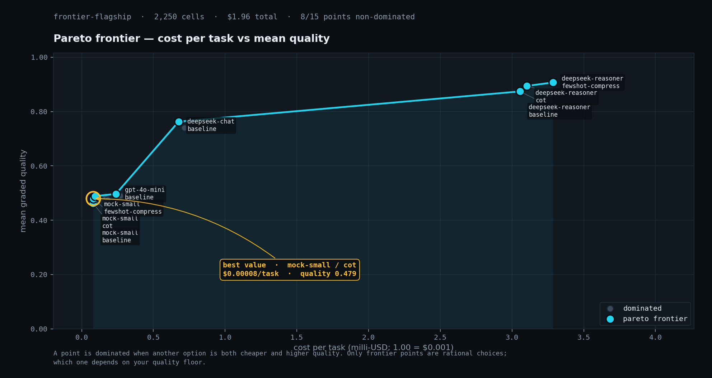
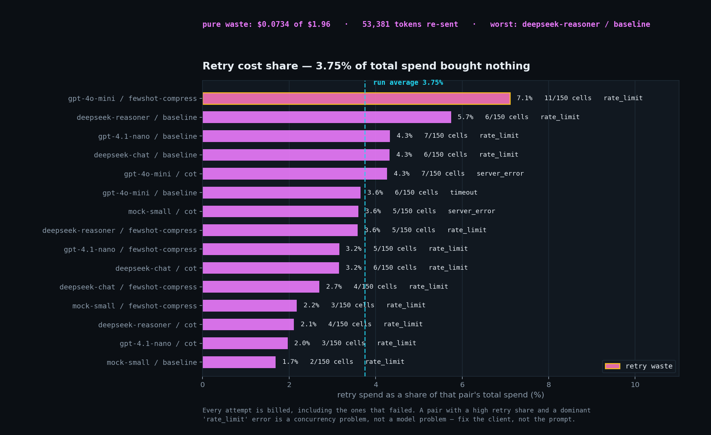
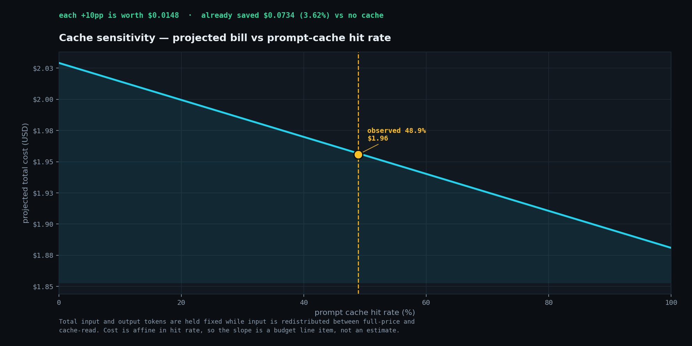

# tokbench

**A token-economics benchmark harness for LLM coding agents.**

[](https://github.com/zzc1-nz/tokbench/actions/workflows/ci.yml)
[](https://www.python.org/downloads/)
[](LICENSE)
[](tests/)
[](#quickstart)

`tokbench` runs the same task set through many `(model × prompt-strategy)` combinations,
records every token that crosses the wire, prices it, grades the answer, and then tells
you — with numbers, not vibes — **which combination buys the most quality per dollar,
and exactly what the extra tokens are buying.**

It is the *benchmarking* counterpart to usage trackers like
[tokscale](https://github.com/kamranahmedse/tokscale) (which watches real sessions) and
realtime HUDs like ai-token-hud (which shows live spend). Those tools answer *"what did I
spend?"*. This one answers *"what **should** I spend, and on what?"*

> **Try it in 30 seconds, no API key:**
> `pip install -e ".[panel]" && tokbench run -c examples/experiment_smoke.yaml && tokbench report --run latest`
>
> Or open the pre-rendered flagship report: **[`docs/example-report.html`](docs/example-report.html)**
> (2,250 cells, 1.99M tokens, $1.96 — a single self-contained file, opens offline).

```console
$ tokbench run -c examples/experiment.yaml
...
| cells           | 2,250 / 2,250                    |
| calls           | 2,332                            |
| failed calls    | 82                               |
| retried cells   | 80                               |
| total tokens    | 1.99M                            |
| billable tokens | 1.51M                            |
| cost            | $1.96                            |
| wall clock      | 79.5s                            |

$ tokbench report --run latest
pareto frontier: mock-small / baseline → mock-small / cot → mock-small / fewshot-compress
              → gpt-4o-mini / baseline → deepseek-chat / baseline
              → deepseek-reasoner / baseline → deepseek-reasoner / cot
              → deepseek-reasoner / fewshot-compress
retry waste 3.75% of spend = $0.0734
```

---

## Why this exists

Token cost is usually managed by *watching a dashboard after the fact*. That tells you the
bill arrived; it doesn't tell you whether it was necessary. The three questions that
actually reduce spend are experimental questions:

1. **Which model tier do I actually need?** Not "which is cheapest" — which is cheapest
   *for the quality level this task class requires*.
2. **Which prompt strategy earns its tokens?** Few-shot examples and chain-of-thought both
   cost input/output tokens. Do they buy enough quality to justify it, or is it habit?
3. **How much am I burning on retries and misses?** Failed calls are billed. So are
   cache misses. Neither shows up in a naive per-call average.

`tokbench` is built to answer exactly those three, which is why its report is organised
around a Pareto frontier, a retry-overhead ledger, and a cache-sensitivity curve.

---

## The headline result

From the bundled 2,250-cell run (`5 models × 3 strategies × 50 tasks × 3 repeats`):

| | |
|---|---|
| **Cells executed** | 2,250 / 2,250 (2,332 API attempts) |
| **Total tokens** | 1.99M (1.51M billable after cache discount) |
| **Total cost** | $1.96 ($0.00129 per 1k billable tokens) |
| **Cache hit rate** | 48.9% |
| **Retry waste** | **3.75% of total spend** ($0.0734) — 80/2,250 cells retried, 82 extra attempts |
| **Pareto frontier** | 8 of 15 candidates non-dominated |
| **Best value** | `mock-small / cot` — $0.000081/task at quality 0.479 |
| **Knee point** | `deepseek-chat / baseline` — $0.000676/task at quality 0.763 |
| **Best quality** | `deepseek-reasoner / fewshot-compress` — quality 0.907 at $0.003285/task |

Three findings that generalise beyond this run:

**1. Quality is monotonic in model tier — and so is price, but not proportionally.**
Mean graded quality on the baseline strategy runs `mock-small` 0.462 → `gpt-4.1-nano` 0.469
→ `gpt-4o-mini` 0.497 → `deepseek-chat` 0.763 → `deepseek-reasoner` 0.874. Moving from the
cheapest tier to `deepseek-chat` buys **+65% quality for 8.5× the cost per task**. Both sit
on the frontier, so neither is "wrong" — but the efficiency curve flattens hard after
`deepseek-chat`, and `deepseek-reasoner` costs a further 4.5× for only **+15% quality**.
That is the shape of a diminishing return, quantified.

**2. Most "prompt improvements" are token-neutral or wasteful.** Across the whole matrix,
CoT costs **+3.3% tokens for +0.007 quality** (neutral), and few-shot+compression costs
**+25.7% tokens for +0.007 quality** (neutral at best). The one place few-shot paid off was
`deepseek-reasoner` (+19.5% tokens, **+0.033 quality** → *worth it*), while for
`gpt-4o-mini` the same strategy was **+30.6% tokens for −0.008 quality** → *wasteful*.
Strategy effects are **model-dependent** — which is exactly why you measure instead of
assuming. A blanket "add few-shot examples everywhere" policy would waste ~25% of the
budget on three of five models.

**3. Retry waste is real, measurable, and concentrated.** 3.75% of spend ($0.0734, 53,381
tokens) bought nothing. It is not spread evenly: `gpt-4o-mini / fewshot-compress` burned
**7.11%** of its own cost on retries (11/150 cells), while `mock-small / baseline` burned
only 1.68%. Dominant error kinds were `rate_limit` (46), `timeout` (19), `server_error` (17).
The fix is targeted — lower concurrency or longer timeouts for the offending pair — rather
than a global "be more careful".

**4. Difficulty is not uniform across task categories — so neither is the right model.**
Averaged over all 15 model/strategy pairs, graded quality ranges from **0.475 on reasoning**
and **0.487 on SQL** up to **0.833 on codegen** and **0.701 on refactoring**. The implication
is directly actionable: for codegen-shaped work a cheap tier is sufficient (the expensive
models are already near 1.0 — `deepseek-reasoner / baseline` scores **1.000** there), while
reasoning and SQL tasks are where the premium tier actually earns its 4.5× price. **Routing
by task category is the single largest saving available** in this data set — bigger than any
prompt-strategy change measured.

---

## Pareto frontier



Cost per task on X (milli-USD, so sub-cent values stay readable), mean graded quality on Y.
Cyan points form the efficient frontier; grey points are dominated (a cheaper *and* better
option exists). The amber ring marks the best-value point.

The frontier answers the only question that matters for model selection: **given a quality
floor, what is the cheapest way to clear it?** Any point above and left of your floor is
waste; any point below is a quality risk. Points *off* the frontier should never be chosen
at any budget — `gpt-4.1-nano` and `mock-small`'s fewshot variant are dominated outright.

Reading it concretely: the frontier is extremely steep near the origin (cheap models gain
quality fast for fractions of a cent), then flattens after `deepseek-chat / baseline`
($0.000676/task, quality 0.763). Below that knee you buy **~504 quality points per USD**;
above it only **~55** — a **9.1× collapse in marginal return**, or $0.0181 per additional
quality point. That flat tail is where token budgets die.

## Failure retry cost share



Per `(model, strategy)` pair: what share of that pair's own spend was pure retry waste. The
dashed line is the 3.75% run-wide average, so each bar reads as "worse or better than
average". The headline is the overall 3.75% ($0.0734 of $1.96, 53,381 tokens re-sent); the
per-bar split shows where to intervene.

`gpt-4o-mini / fewshot-compress` is the outlier at 7.11% — nearly twice the average, driven
by `rate_limit`. That is a concurrency bug, not a model problem: the fix is to cap that
pair's in-flight requests, not to change the prompt.

## Cache sensitivity



Projected total bill as prompt-cache hit rate varies, holding token counts fixed. Because
cost is affine in hit rate, the curve is a straight line with a slope you can budget
against: each **+10pp of hit rate is worth $0.0148** here. The observed 48.9% already saves
**$0.0734 (3.62%)** versus no cache; reaching 100% would save a further $0.0748.

---

## How it works

```
experiment.yaml
      │
      ▼
┌─────────────┐   deterministic cell expansion
│   runner    │   models × strategies × tasks × repeats
└──────┬──────┘   retry policy · budget ceiling · thread pool
       │
       │  one CallRecord per attempt → calls.jsonl   (append-only, fsync'd)
       │  one TaskResult per cell    → results.jsonl
       ▼
┌─────────────┐
│  analysis   │   leaderboard · Pareto · retry ledger · cache curve · ablation deltas
└──────┬──────┘
       │  ReportPayload  (one frozen schema)
       ├────────────────────────┐
       ▼                        ▼
┌─────────────┐          ┌─────────────┐
│ render/html │          │ panel/app   │
│ 1-file HTML │          │ Streamlit   │
└─────────────┘          └─────────────┘
```

Each arrow is a **stable data contract** (`models.py`, `report_schema.py`), which is why the
engine, the analytics, and the two renderers were built and tested independently.

### Adapter pattern

Adding a provider means implementing one method:

```python
class BaseAdapter(abc.ABC):
    provider: str
    supports_cache_accounting: bool

    @abc.abstractmethod
    def complete(self, request: AdapterRequest) -> AdapterResponse: ...

    def preflight(self) -> list[str]: ...   # credential warnings
```

Shipped adapters: `openai`, `anthropic`, `deepseek`, `ollama`, and `mock`.

**The one architectural rule: adapters count tokens, they never price them.** Every adapter
returns provider-reported token counts (or a labelled estimate); `pricing.py` turns counts
into USD. That separation means you can re-price an entire historical run —
`tokbench report --prices my-negotiated-rates.yaml` — with zero API calls, and the cost
model stays auditable in a single file.

Every adapter normalises provider failures into one `ErrorKind` enum
(`rate_limit`, `timeout`, `server_error`, `auth`, `context_overflow`, …), which is what makes
the retry policy and the retry-overhead analysis provider-agnostic.

---

## Quickstart

```bash
pip install -e ".[panel]"

# 1. Validate the experiment plan (no API calls)
tokbench validate -c examples/experiment.yaml

# 2. Run it — mock mode needs no API key, no network, and is fully deterministic
tokbench run -c examples/experiment.yaml

# 3. Analyse + render
tokbench report --run latest

# 4. Explore interactively
tokbench panel
```

The bundled config runs in **mock mode**: a deterministic adapter that simulates token
accounting, latency, failure injection (~3%), and tier-dependent answer quality. It exists so
the whole pipeline is inspectable, reproducible, and testable **without spending a cent** —
and so the test suite has no network dependency.

To run against real providers, set `adapter_mode: live` and switch each model's `provider`:

```yaml
adapter_mode: live
models:
  - id: ds-chat
    provider: deepseek
    model: deepseek-chat
    env_key: DEEPSEEK_API_KEY
    max_output_tokens: 1024
```

---

## Experiment config

```yaml
experiment:
  name: frontier-flagship
  repeats: 3          # variance control — 3 draws, not 1 lucky one
  concurrency: 8

taskset:
  path: ../tasks/coding_bench.jsonl    # resolved relative to this file

models:                # what you're comparing
  - {id: deepseek-chat,      provider: mock, model: deepseek-chat}
  - {id: deepseek-reasoner,  provider: mock, model: deepseek-reasoner}
  - {id: gpt-4o-mini,        provider: mock, model: gpt-4o-mini}
  - {id: gpt-4.1-nano,       provider: mock, model: gpt-4.1-nano}
  - {id: mock-small,         provider: mock, model: mock-small}

strategies:            # the experimental variable
  - id: baseline       # control arm: short system, no examples, no CoT
    system_prompt_preset: short
    few_shot: 0
    cot: false
    compress_tool_output: false

  - id: cot            # baseline + "think step by step"
    cot: true

  - id: fewshot-compress   # +3 exemplars, +tool-output compression
    few_shot: 3
    compress_tool_output: true

retry:
  max_attempts: 3
  backoff_base_s: 0.5
  backoff_max_s: 8.0
  retry_on: [rate_limit, timeout, server_error, network]   # never retry a bad request

budget:
  max_total_tokens: 5000000    # graceful abort, partial data still written
```

### Strategies are single-variable ablations

Each `StrategySpec` field maps to one concrete prompt-assembly decision, and the runner never
rewrites messages — so a token delta between two rows of the report is attributable to a
*named field*, not to "the prompt".

| knob | effect | where it shows up |
|---|---|---|
| `system_prompt_preset` | `none` / `short` / `medium` / `long` (~15 → 1,200 tokens) | fixed input overhead per call |
| `few_shot` | 0–16 category-matched exemplars | input tokens, scales linearly |
| `cot` | appends a reasoning instruction | output tokens (longer answers) |
| `compress_tool_output` | replaces a 1.3k-token tool payload with a shape summary | input tokens on agentic tasks |

`prompt.assemble_prompt` returns a per-component breakdown (`system`, `few_shot`, `cot`,
`task`, `tool`), so the report can explain *which component* drove a delta — not just that
one exists.

---

## The benchmark set

`tasks/coding_bench.jsonl` — 50 real engineering tasks, 8 categories:

| category | n | category | n |
|---|---:|---|---:|
| codegen | 10 | sql | 5 |
| debug | 8 | explain | 5 |
| refactor | 6 | tool-use | 6 |
| test-gen | 6 | reasoning | 4 |

Python 11, SQL 8, TypeScript 7, architecture 7, Rust 6, Go 5, shell 3. Prompts average 385
chars; the six tool-use tasks carry realistic 1.1k–1.5k-token JSON tool payloads (that's the
input the compression strategy ablates). Difficulty spans 0.2–0.9, with three deliberately
ambiguous tasks so quality scores spread.

Grading is deterministic and offline: `must_include` substring checks where needles exist,
`exact_match` where a short reference does, structural heuristics otherwise.

---

## Cost model

Token accounting is normalised across providers:

```
total_tokens    = input_tokens + output_tokens            # rate limits, context windows
uncached_input  = input_tokens − cache_read − cache_write  # what you pay full price for
billable_tokens = uncached_input + output_tokens          # THE ranking denominator
```

`billable_tokens` — not `total_tokens` — is the leaderboard denominator, because a cache hit
costs a fraction of a fresh token and ranking on raw volume would penalise the exact behaviour
you want to reward.

```
cost = (uncached_input × P_in + cache_read × P_cache_read
      + cache_write  × P_cache_write + output × P_out + reasoning × P_reason) / 1e6
```

Prices live in a swappable price book (`pricing.py`), defaulting to a 2026 public-list
snapshot. Defaults when a provider doesn't publish a separate cache price:
`P_cache_read = 0.1 × P_in`, `P_cache_write = 1.25 × P_in`.

### Cache sensitivity

Holding input and output token counts fixed, the projected bill is **affine** in cache hit
rate `h`:

```
cost(h) = ((1−h)·input·P_in + h·input·P_cache_read + output·P_out) / 1e6
```

So every percentage point of hit rate saves a fixed, predictable amount. In the flagship run
the observed 48.9% hit rate already saved **$0.0734 (3.62%)** versus no cache, and each
additional **+10pp is worth $0.0148**. That linearity is what makes caching a *budget line
item* rather than a hope.

The hit-rate denominator is `input_tokens − cache_write_tokens`, not `input_tokens`: a cache
*write* is a miss that populates the cache, so counting writes as misses would make a run
that aggressively warms its cache look worse than one that never caches at all. That single
definition is used by the summary KPI, the running time-series ratio, and the sensitivity
curve — so one run can never report two different hit rates.

---

## CLI

| command | purpose |
|---|---|
| `tokbench run -c exp.yaml` | execute the matrix (`--dry-run`, `--limit N`, `--quiet`) |
| `tokbench report --run latest` | analyse + render JSON/HTML (`--prices`, `--baseline`, `--open`) |
| `tokbench show --run latest` | terminal summary + leaderboard, writes nothing |
| `tokbench list` | discover runs under a directory |
| `tokbench validate -c exp.yaml` | check config, taskset, prices, and the token plan |
| `tokbench panel` | launch the Streamlit dashboard |
| `tokbench providers` | list adapters and their credential requirements |

Every command is a thin shell over `runner` / `analysis` / `render`, so the same pipeline is
drivable from a notebook or CI without the CLI.

---

## Web panel

`tokbench panel` launches a Streamlit dashboard over any run directory:

- **Overview** — KPIs, leaderboard
- **Pareto** — interactive cost/quality scatter with the frontier highlighted
- **Tokens** — cumulative time series + stacked token-type decomposition
- **Retry** — per-pair retry spend and error-kind breakdown
- **Cache** — sensitivity curve with a what-if hit-rate slider
- **Ablation** — strategy delta table with verdicts
- **Raw** — full call/result frames with CSV/JSON download

The static HTML report is the portable artifact: a **single self-contained file** with
hand-authored inline SVG charts, no CDN, no fonts, no JS dependencies. It opens offline and
prints cleanly — drop it in a PR or attach it to a review.

---

## Engineering notes

**Reproducibility.** The config is hashed and snapshotted into the run directory, so a run is
self-describing. Cell expansion order is fixed and documented, so a budget-aborted run is a
*prefix* of the matrix rather than a random subset. The mock adapter derives every token
count from `sha256(cache_key)`: same input, byte-identical output.

**Crash safety.** The call log is append-only JSONL, `fsync`'d per line. A crash or a budget
abort leaves a valid partial dataset, never a corrupt one.

**One number, one owner.** Every derived quantity is computed in exactly one place and then
*published* in the report payload. The knee point is `ParetoFrontier.knee_label`, the cache
hit rate is `Usage.cache_hit_rate` (= `cache_read / (input − cache_write)`, one definition
used by the KPI, the time series and the sensitivity curve), and cost is only ever computed
in `pricing.py`. Renderers read these fields; they never re-derive them. That discipline is
what stops the HTML report, the Streamlit panel and the README figures from quietly
disagreeing about the same run — a failure mode that is invisible until someone puts two of
the artifacts side by side.

**Budget ceilings.** `max_total_tokens` / `max_cost_usd` / `max_calls` are checked after each
call; breaching one stops scheduling new cells gracefully and still finalises the manifest.
A half-finished run is data, not a crash.

**Honest limitations.**
- Quality grading is heuristic (substring + structural), a cheap proxy for human eval.
  Scores are comparable *within* a run, not absolute.
- Mock-mode numbers are synthetic: they validate the pipeline and the cost model, not the
  models. The bundled demo exists so the tool is inspectable without an API key.
- Prices drift, and negotiated rates differ. Pass `--prices` before quoting a figure.
- 3 repeats controls variance, it is not a significance test. Use 5+ before claiming a small
  quality delta is real.

Full derivations: [`docs/METHODOLOGY.md`](docs/METHODOLOGY.md).
Measured results of the bundled run, with reproducibility notes: [`docs/RESULTS.md`](docs/RESULTS.md).

---

## Tests

```bash
python -m pytest -q        # 199 tests
```

Covers: mock determinism, retry policy and backoff, budget abort semantics, resume,
prompt-assembly monotonicity, hand-computable Pareto membership and knee, exact retry
arithmetic, cache-curve monotonicity, empty/zero-token safety, JSONL round-tripping, XSS
escaping in the HTML renderer, and taskset constraints.

Beyond unit tests, two scripts verify the things unit tests structurally cannot:

```bash
python scripts/check_panel_render.py reports/<run-id>   # boots the real Streamlit runner
python scripts/verify_panel_import_guard.py             # proves the import guard is load-bearing
```

The second one exists because `streamlit run app.py` executes the panel as a bare script with
no package context, so `from ..models import ...` raises *"attempted relative import with no
known parent package"*. Import-only tests pass while the actual command fails. The guard
script deliberately breaks the bootstrap and asserts the regression test catches it.

## Layout

```
tokbench/
├── tokbench/
│   ├── models.py          # Usage, CallRecord, TaskResult, Task, RunManifest
│   ├── report_schema.py   # ReportPayload — the analysis↔render contract
│   ├── config.py          # ExperimentConfig + deterministic cell expansion
│   ├── pricing.py         # price book + cost model (the only place money is computed)
│   ├── errors.py          # ErrorKind taxonomy driving retry policy
│   ├── store.py           # run directories, append-only JSONL
│   ├── cli.py             # Typer entry point
│   ├── adapters/          # base contract + openai/anthropic/deepseek/ollama/mock
│   ├── prompt.py          # strategy → messages, with per-component token breakdown
│   ├── grader.py          # deterministic offline quality scoring
│   ├── runner.py          # matrix execution, retry, budget, manifest
│   ├── analysis/          # aggregate · pareto · retry · cache · deltas · report
│   ├── render/            # self-contained HTML with inline SVG
│   └── panel/             # Streamlit dashboard
├── tasks/coding_bench.jsonl   # 50-task benchmark
├── examples/                  # flagship, smoke, and price-overlay configs
├── docs/METHODOLOGY.md        # every formula, derived
├── docs/RESULTS.md            # measured outcome + reproducibility
├── docs/example-report.html   # pre-rendered flagship report (opens offline)
└── tests/
```

## License

MIT
